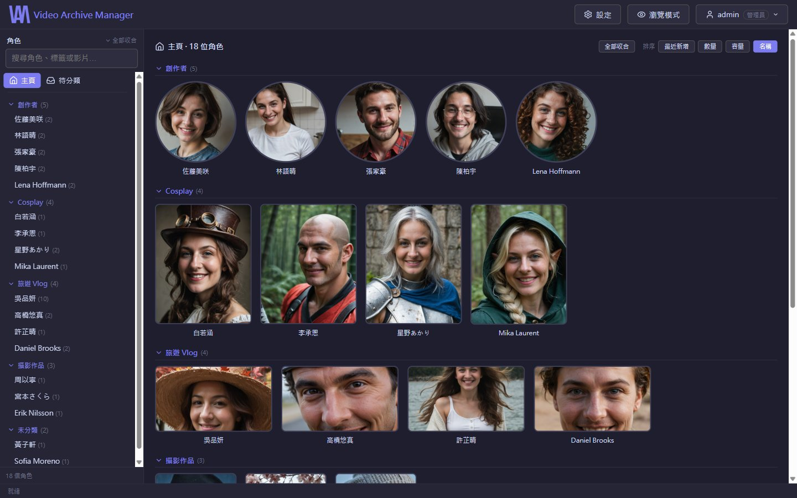
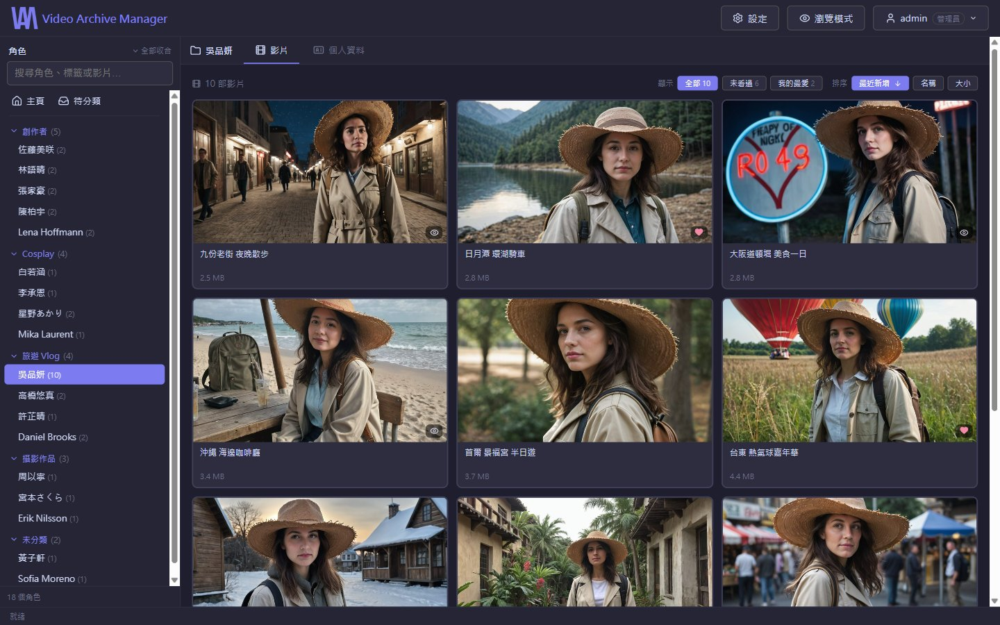
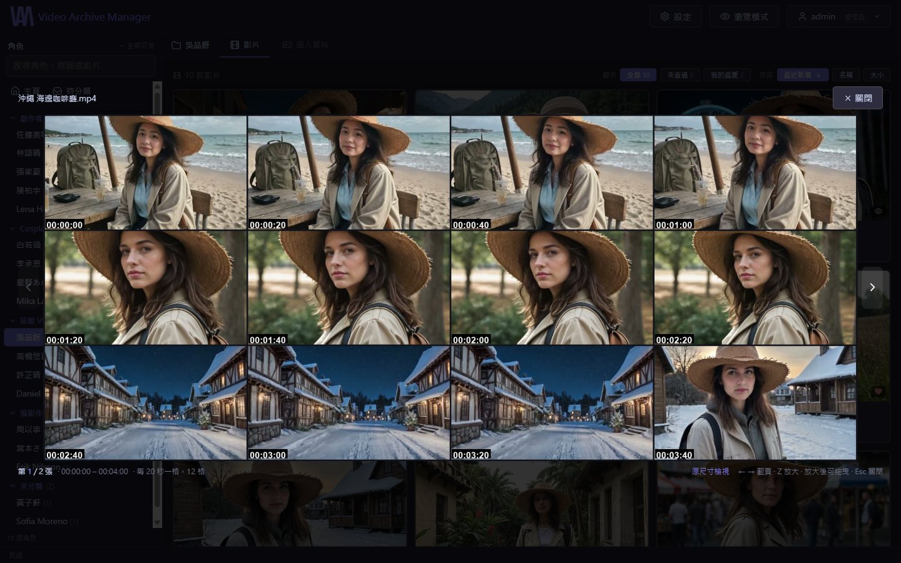
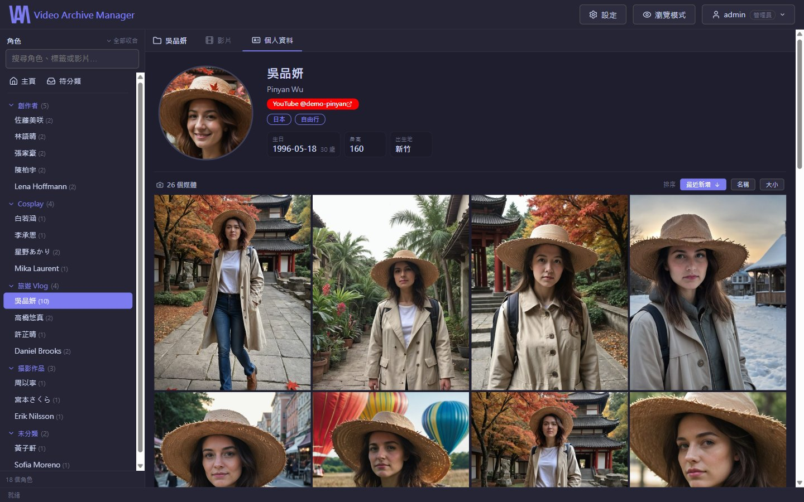
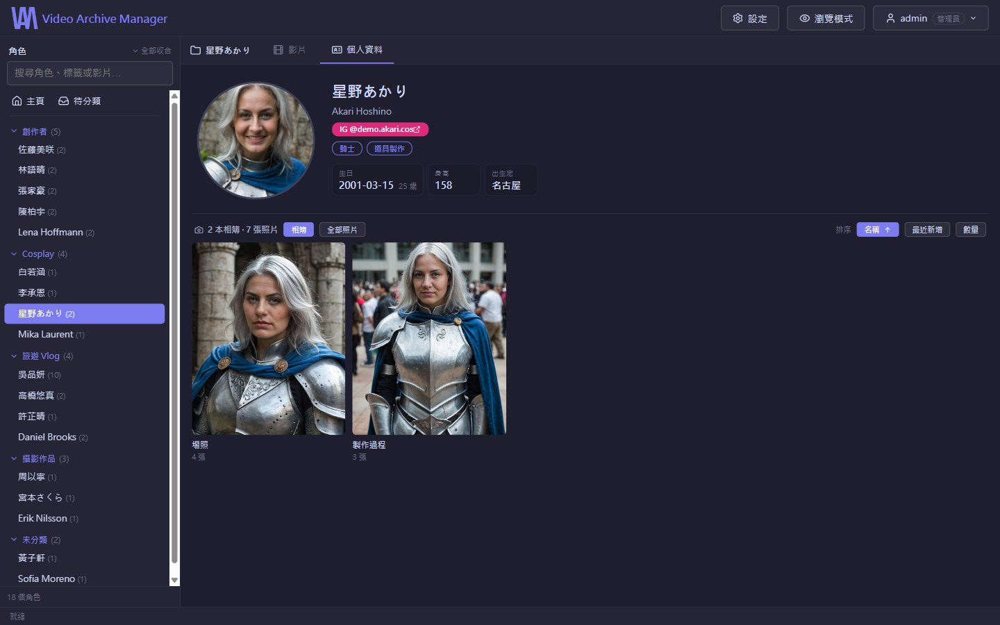
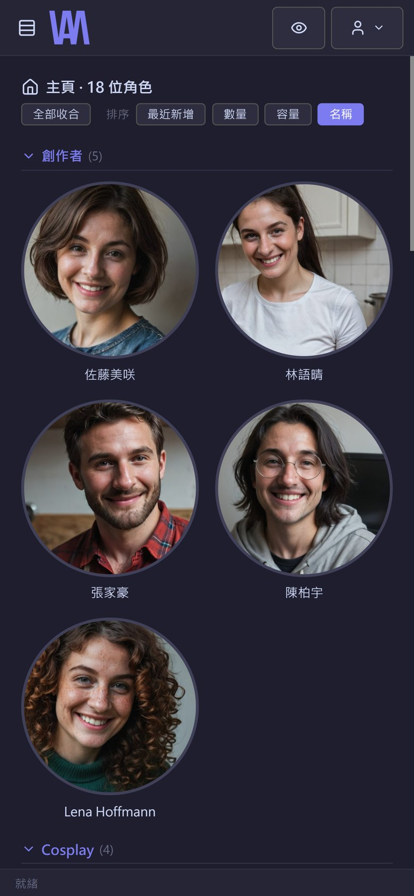
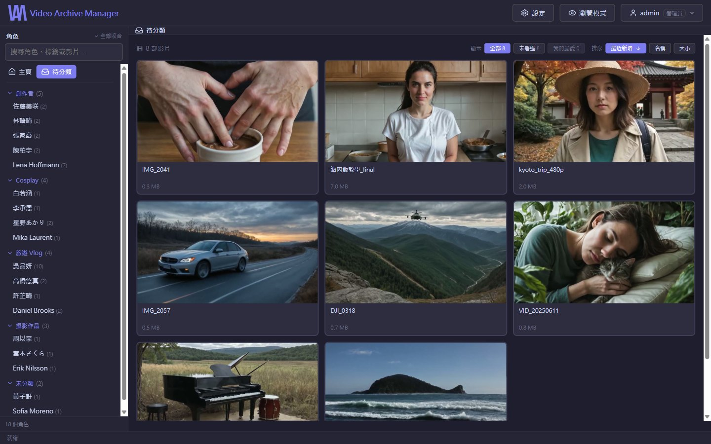
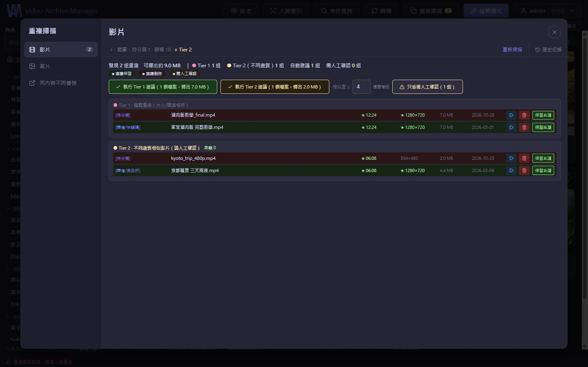
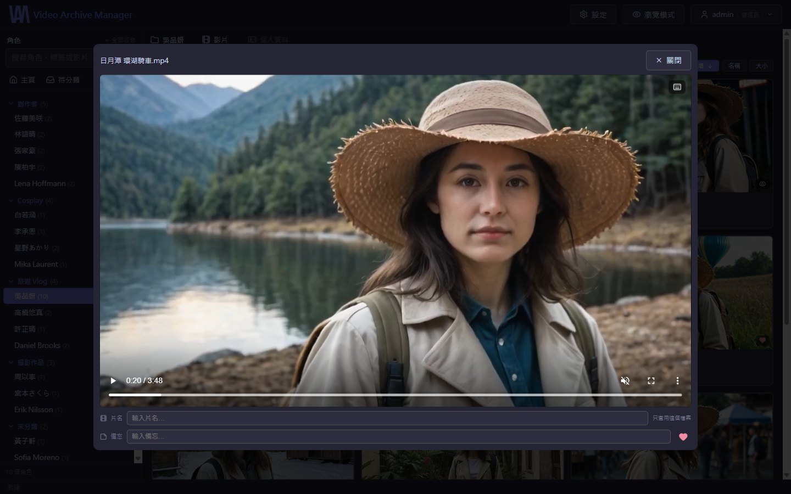
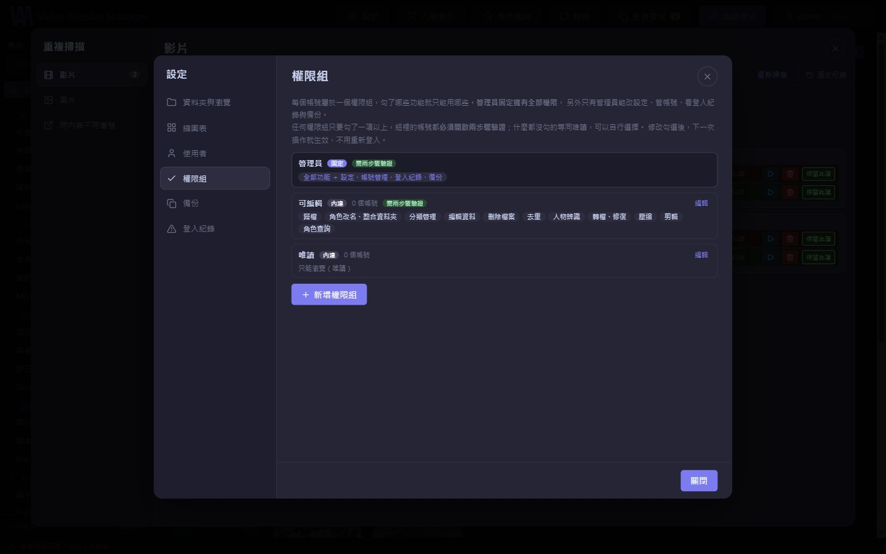

<p align="center">
  
</p>

<p align="center"><b>繁體中文</b> ｜ <a href="README.en.md">English</a></p>

# Video Archive Manager（VAM）

VAM 是一套自行架設（Self-hosted）的影片與照片收藏管理系統，專門用來管理大量、分散於本機硬碟與 NAS 的影音收藏。

系統透過瀏覽器操作，電腦、手機、平板都能用，不需要在每台裝置安裝客戶端。

實測規模：

- 🎬 **30,000+ 部影片**
- 👤 **730 位角色**
- 🖼️ **160,000+ 張照片**
- 💾 分散在 8 顆本機硬碟與 NAS

> VAM 只管理你自己的檔案，**不包含、也不提供任何影音內容**。

<p align="center"></p>

<sub>本頁截圖都來自示範資料庫：人物與照片皆為 AI 生成的虛構角色。</sub>

---

## 核心概念

VAM 以 **「角色（Person）」** 為主要的資料整理核心。

每位角色都有自己的資料夾，其中可以包含：

- 影片與照片
- 個人資料（`person_info.json`，和檔案放在一起，搬資料夾就跟著走）
- 社群連結與標籤
- 觀看紀錄、我的最愛、片名、發行日

新下載的內容會先進入 **「待分類」**。確認內容後再歸檔到對應角色，觀看紀錄、片名等資料會跟著檔案一起搬，不用重新整理。

---

# ✨ 主要功能

## 🎬 影片瀏覽與觀看

- **自訂分類**：主頁依分類顯示角色，每個分類可以選卡片形狀（圓形、16:9、4:5、9:16）與是否用封面圖。
- **排序與篩選**：名稱、檔案大小、最近新增、發行日期；快速篩選 **未看過**、**我的最愛**。
- **全庫搜尋**：用檔名或番號找片，番號的大小寫、連字號寫法不同也找得到。
- **縮圖表（Contact Sheet）**：把影片不同時間點的畫面整理成一張預覽圖，不用播完就知道內容，也能直接從縮圖選剪輯範圍。
- **封面**：認得 Kodi／Jellyfin 慣例的 `番號-poster.jpg`（直式）與 `番號-fanart.jpg`（橫式），依卡片比例自動選圖。
- **播放器**：外掛字幕（SRT／ASS／VTT，雙語字幕自動合併）、觀看紀錄、備忘、手動片名、音量記憶與快捷鍵。

<table>
  <tr>
    <td width="50%"></td>
    <td width="50%"></td>
  </tr>
  <tr>
    <td align="center">角色的影片：封面、看過與最愛標記、篩選與排序</td>
    <td align="center">縮圖表：不用播完就知道內容</td>
  </tr>
</table>

## 🖼️ 照片管理

- 每位角色獨立的照片牆，可依時間、名稱、檔案大小、**相似度**（構圖＋顏色）排序，也能用相簿方式瀏覽。
- 縮圖由伺服器產生並快取，點開才是原圖。
- **手機版**：照片上下滑動切換、雙指縮放，介面針對觸控重新排版。

<table>
  <tr>
    <td width="40%"></td>
    <td width="40%"></td>
    <td width="20%"></td>
  </tr>
  <tr>
    <td align="center">個人資料、社群連結與照片牆</td>
    <td align="center">依子資料夾分成相簿</td>
    <td align="center">手機版</td>
  </tr>
</table>

---

# 🗂️ 整理與歸檔

- **待分類工作流程**：預覽、觀看、確認後歸檔；搬移檔案時可以繼續選下一部。
- **整包歸檔**：一次把整個資料夾歸到某位角色。
- **角色管理**：改名、合併角色資料夾、自訂標籤（可直接用來篩選）、社群連結、個人資料、大頭照框選。
- **NFO**：讀入與寫出 Kodi／Jellyfin／Emby 的 `.nfo`，讀入時只補空的欄位，不覆蓋你改過的。

<p align="center"></p>

---

# 🔍 重複檔案掃描

- **影片**：先比大小與雜湊（完全相同），再比時長與畫面指紋（同一部、不同畫質或版本），並建議保留哪一個。
- **圖片**：比對完全相同與高度相似的照片，認得浮水印版本。
- 掃描可以中途停止、伺服器重啟後自動接回；刪除前都會先列清單給你確認。

<p align="center"></p>

---

# 🤖 AI 輔助整理（選用，另外安裝）

- **人物偵測**：找出照片資料夾裡「沒有人物」的照片（風景、食物、物品），方便清理。有 NVIDIA GPU 時每張約 0.07 秒；沒有也能跑，慢約 5 倍。
- **人臉辨識**：對待分類的影片做人臉分析，根據已建立的角色建議可能是誰。需要 NVIDIA GPU。

沒安裝的話，這兩個功能會在介面上直接說明缺了什麼套件或模型，其他功能完全不受影響。安裝方式見下方「AI 功能」。

---

# 🎞️ 影片處理工具

所有會改動影片的工具都有**驗證**步驟：驗不過就不刪原檔。

- **轉檔**：瀏覽器播不了的影片，優先嘗試**不重新編碼的換殼（Remux）**，必要時才重新編碼。
- **修復**：搶救被誤標成 `.ts` 的分段 MP4、遮蔽損壞的畫面、修正聲音斷訊與錄影中斷、修正造成卡頓的影格時間。
- **完整解碼檢查**：逐格解碼一遍，找出看起來正常、其實中間壞掉的檔案。
- **壓縮**：重新編碼換取空間，**一律另存新檔**；可以把原始版本與壓縮版本並排同步播放，比較畫質後再決定留哪個。
- **✂️ 剪輯**：一次選多個片段並合併成一支影片；先從縮圖表選大致範圍，再用播放器微調。可選「快速（吸附關鍵幀、不損失畫質）」或「精準到格（重新編碼）」。

<p align="center"></p>

---

# 📚 資料補齊（角色查詢）

- **片名與發行日**：用番號查 DMM 的公開目錄，取得日文原名與發行日；查不到的再找 JAVDatabase。
- **封面**：同時下載直式封面與橫式封套，存成影片旁的 `-poster.jpg`／`-fanart.jpg`。
- **個人資料與大頭照**：從 JAVDatabase 補齊生日、身高等欄位；大頭照候選來自 [Gfriends](https://github.com/gfriends/gfriends) 圖庫。已有的資料逐欄列出「目前 → 新值」，勾選才取代。
- **匯入自己存下的網頁**：Seesaa Wiki、IAFD、AVBase。解析作品清單、別名、個人資料，以及「哪部是從哪部剪出來的」收錄關係（總集編、精選）。
- **共演**：從資料推算哪些角色一起出演過。

> 資料來源都是公開網站。請遵守各網站的使用條款；VAM 不繞過任何地區限制或防護機制。

---

# 🔐 帳號、權限與安全

- **權限組**：管理員可以自訂權限組，逐項勾選能用哪些功能（歸檔、刪除、去重、轉檔、剪輯、角色查詢…）。權限在伺服器端強制，不是只把按鈕藏起來。
- **可存取的資料夾**：每個帳號可以限制只看得到哪些根目錄。
- **兩步驟驗證**：TOTP（Google Authenticator 等）＋備用碼；有編輯權限的帳號強制開啟。QR code 在本機產生，金鑰不經過任何外部服務。
- **登入防護**：「帳號＋位址」「位址」「帳號」三條節流規則，逐步拉長鎖定時間；密碼強度規則；IP 白名單。
- **異常通知**：從沒用過的位址登入成功、兩步驟驗證被關閉等事件會提醒管理員；可以查看並登出任一台登入中的裝置。
- **對外連線**：預設只接受區網與 VPN 來源。要從外面連時，可搭配 Caddy 申請正式 HTTPS 憑證（範本在 `caddy/Caddyfile.example`）。
- **備份**：每天把資料庫備份到你指定的另一顆硬碟。

<p align="center"></p>

---

# 🚀 安裝與執行

目前在 **Windows 10／11** 上開發與使用，啟動腳本是 `.bat`。後端是 Python，理論上也能在 Linux／macOS 執行，但沒有測試過。

安裝分三層，**只有第一層是必要的**。缺少的選用元件不會讓 VAM 壞掉：對應的功能會在介面上說明缺了什麼。

| 功能 | 需要 | 屬於 |
|---|---|---|
| 瀏覽、播放、歸檔、角色管理、影片去重、資料補齊、帳號權限 | Python、`requirements.txt` | 1. 基本 |
| **剪輯、轉檔、壓縮、修復、縮圖表、讀取影片時長** | **FFmpeg** | 1. 基本 |
| 網頁介面（建置一次） | Node.js | 1. 基本 |
| 縮圖表拼貼、照片縮圖、圖片去重、相似排序 | Pillow | 2. 建議 |
| 影格時序修復 | GPAC 的 `MP4Box` | 2. 選用 |
| 人臉辨識 | `requirements-ai.txt`、NVIDIA GPU | 3. AI |
| 人物偵測 | `requirements-ai.txt`、模型檔（GPU 選用） | 3. AI |

### 1. 基本安裝

先安裝三個程式（以 Windows 的 winget 為例，也可以到官網下載）：

```bat
winget install Python.Python.3.11
winget install Gyan.FFmpeg
winget install OpenJS.NodeJS.LTS
```

裝完**重新開一個命令列視窗**，確認 `python --version`、`ffmpeg -version`、`node --version` 都有回應。
FFmpeg 必須在 PATH 裡：剪輯、轉檔、縮圖表都是呼叫它完成的。有 NVIDIA 顯示卡時，轉檔會自動改用顯示卡編碼，不需要另外設定。

下載 VAM 並安裝 Python 套件：

```bat
git clone https://github.com/lawlint312/Video-Archive-Manager.git
cd Video-Archive-Manager
pip install -r backend/requirements.txt
```

建置網頁介面。只需要做一次，之後執行 VAM 時用不到 Node：

```bat
cd frontend
npm install
npm run build
cd ..
```

第一次啟動前，設定管理員密碼（沒設的話會產生一組亂數密碼，寫在 `data\logs\` 的記錄檔裡）：

```bat
set VAM_ADMIN_PASSWORD=你的密碼
start.bat
```

然後打開 **http://localhost:8301/**，用 `admin` 登入，到 **設定 → 資料夾與瀏覽** 加入你的收藏根目錄與待分類資料夾。

### 2. 建議與選用元件

**建議**安裝 Pillow，縮圖表、照片縮圖、圖片去重、相似排序都需要它：

```bat
pip install Pillow
```

**選用**：影格時序修復需要 GPAC 的 MP4Box：

```bat
winget install GPAC.GPAC
```

裝完重新啟動 VAM（`stop.bat` 再 `start.bat`）。

### 3. AI 功能（選用）

需要的空間與條件比其他功能大得多，請先確認需要再裝：

- 硬碟約 **10 GB**（PyTorch 的 GPU 版就佔 7.5 GB）
- **NVIDIA 顯示卡**與較新的驅動程式（套件使用 CUDA 12.9）；CUDA 與 cuDNN 由 pip 一併安裝，不必另外裝
- Windows 上 `insightface` 沒有預先編譯好的版本，安裝時要編譯，需要先裝
  [Microsoft C++ Build Tools](https://visualstudio.microsoft.com/visual-cpp-build-tools/)（勾選「使用 C++ 的桌面開發」）

```bat
pip install -r backend/requirements-ai.txt
```

**人臉辨識**：裝完套件即可。第一次使用時會自動下載 insightface 的 `buffalo_l` 模型（約 300 MB）。
⚠ 這個模型的授權**只限非商業研究用途**，使用前請自行確認 [insightface 的授權條款](https://github.com/deepinsight/insightface#license)。

**人物偵測**：另外需要模型檔。從 Hugging Face 的
[Bingsu/adetailer](https://huggingface.co/Bingsu/adetailer/blob/main/person_yolov8m-seg.pt)
下載 `person_yolov8m-seg.pt`（約 55 MB），放到：

```
data\models\person_yolov8m-seg.pt
```

重新啟動 VAM 後，到角色的照片頁就能使用「辨識人物」與「沒有人物」篩選。

### 資料夾結構

```
收藏根目錄\
├── 角色 A\                    ← 一個資料夾就是一位角色
│   ├── person_info.json      ← 個人資料、標籤、連結（在 VAM 裡編輯時寫入）
│   ├── 影片1.mp4
│   ├── 番號-poster.jpg        ← 選用：封面
│   └── 照片1.jpg
└── 角色 B\...
```

### 啟動方式

| 檔案 | 做什麼 |
|---|---|
| `start.bat` | 手動啟動，只有這台電腦連得到 |
| `start-lan.bat` | 同上，但開放給同一個區網的手機、平板 |
| `start-hidden.vbs`／`start-lan-hidden.vbs` | 沒有視窗，放進「啟動」資料夾就能開機自動執行 |
| `status.bat` | 有沒有在跑、監聽哪裡、最新的記錄 |
| `stop.bat` | 停止 |

詳細說明見 `README-startup.txt`。

### 環境變數

| 變數 | 預設 | 說明 |
|---|---|---|
| `VAM_ADMIN_USER`／`VAM_ADMIN_PASSWORD` | `admin`／亂數 | 第一次啟動時建立的管理員 |
| `VAM_HOST`／`VAM_PORT` | `127.0.0.1`／`8301` | 監聽位址 |
| `VAM_DATA_DIR` | `data\` | 資料庫、記錄檔 |
| `VAM_CACHE_DIR` | `cache\thumbs\` | 縮圖快取（可以隨時刪除，會自己長回來） |
| `VAM_SESSION_DAYS` | `7` | 登入有效天數 |

### 測試

每個測試檔都可以單獨執行。後端的在 `backend\tests\`，前端的在 `frontend\tests\`：

```bat
cd backend
python -X utf8 tests\test_security.py
cd ..\frontend
node tests\mount.test.mjs
```

測試只使用暫存資料夾與 `testdata\` 裡的人造素材，不會碰到你的收藏。

---

# 🎯 VAM 想解決的問題

當影片與照片收藏逐漸增加到數千甚至數萬個檔案後，真正困難的通常已經不是「播放影片」，而是：

**如何找到、分類、辨識、整理、去重，以及長期維護這些收藏。**

VAM 將影片瀏覽、角色管理、照片管理、重複掃描、人臉辨識、人物偵測、影片轉檔、壓縮、剪輯與外部資料匯入整合在同一套 Web 系統中。

> **讓管理大量影音收藏，從繁瑣的檔案整理工作，變成可以透過瀏覽器快速完成的日常流程。**

---

## 授權

Copyright © 2026 lawlint312

本專案以 [GNU Affero General Public License v3.0](LICENSE)（AGPL-3.0）授權：可以自由使用、修改與散布；修改後的版本——包含架設成網路服務讓別人使用——必須以相同授權公開原始碼。

本專案使用 Claude Code 協助開發。
