<p align="center">
  
</p>

<p align="center"><a href="README.md">繁體中文</a> ｜ <b>简体中文</b> ｜ <a href="README.en.md">English</a></p>

# Video Archive Manager（VAM）

VAM 是一套自托管（Self-hosted）的视频与照片收藏管理系统，专门用来管理大量、分散在本地硬盘与 NAS 上的影音收藏。

系统通过浏览器操作，电脑、手机、平板都能用，不需要在每台设备上安装客户端。

实测规模：

- **30,000+ 个视频**
- **730 位角色**
- **160,000+ 张照片**
- 分散在 8 块本地硬盘与 NAS 上

> VAM 只管理你自己的文件，**不包含、也不提供任何影音内容**。
>
> 界面有**繁体中文、简体中文、English** 三种语言，每个账号在右上角的账号菜单中各自选择。

<p align="center">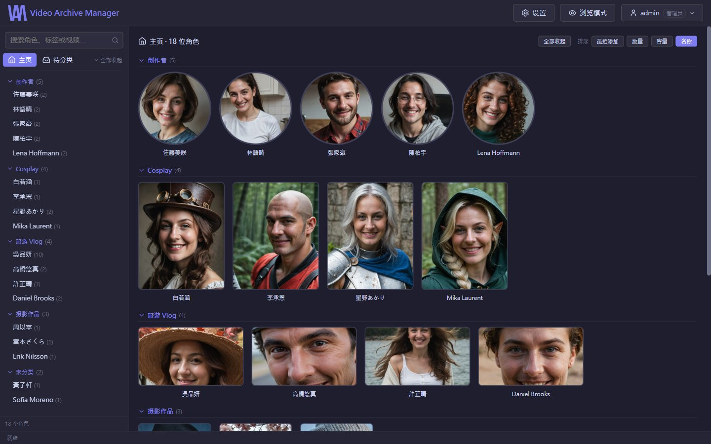</p>

<sub>本页截图均来自演示数据库：人物与照片都是 AI 生成的虚构角色。</sub>

---

## 核心概念

VAM 以 **“角色（Person）”** 为主要的数据整理核心。

每位角色都有自己的文件夹，其中可以包含：

- 视频与照片
- 个人资料（`person_info.json`，和文件放在一起，移动文件夹时数据也跟着走）
- 社交链接与标签
- 观看记录、收藏、片名、发行日期

新下载的内容会先进入 **“待分类”**。确认内容后再归档到对应角色，观看记录、片名等数据会跟着文件一起移动，不用重新整理。

---

# 主要功能

## 视频浏览与观看

- **自定义分类**：主页按分类显示角色，每个分类可以选择卡片形状（圆形、16:9、4:5、9:16）以及是否使用封面图。
- **排序与筛选**：名称、文件大小、最近添加、发行日期；快速筛选 **未看过**、**收藏**。
- **全库搜索**：用文件名或番号找片，番号的大小写、连字符写法不同也能找到。
- **缩略图表（Contact Sheet）**：把视频不同时间点的画面整理成一张预览图，不用看完就知道内容，也能直接从缩略图选择剪辑范围。
- **封面**：识别 Kodi／Jellyfin 惯例的 `番号-poster.jpg`（竖版）与 `番号-fanart.jpg`（横版），按卡片比例自动选图。
- **播放器**：外挂字幕（SRT／ASS／VTT，双语字幕自动合并）、观看记录、备注、手动片名、音量记忆与快捷键。

<table>
  <tr>
    <td width="50%">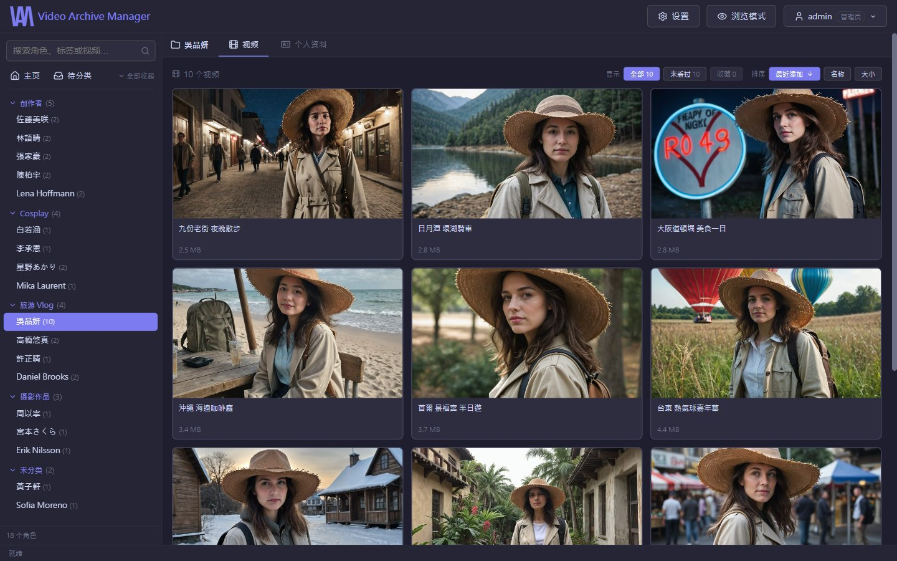</td>
    <td width="50%">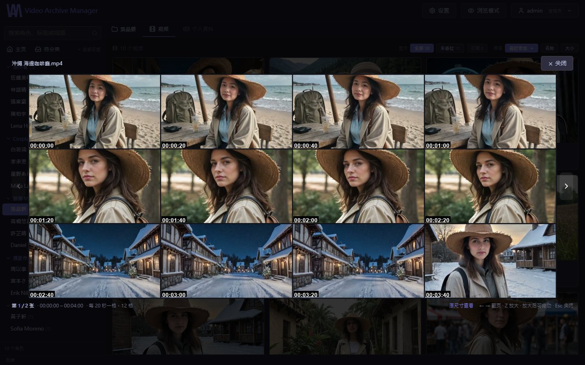</td>
  </tr>
  <tr>
    <td align="center">角色的视频：封面、看过与收藏标记、筛选与排序</td>
    <td align="center">缩略图表：不用看完就知道内容</td>
  </tr>
</table>

<p align="center">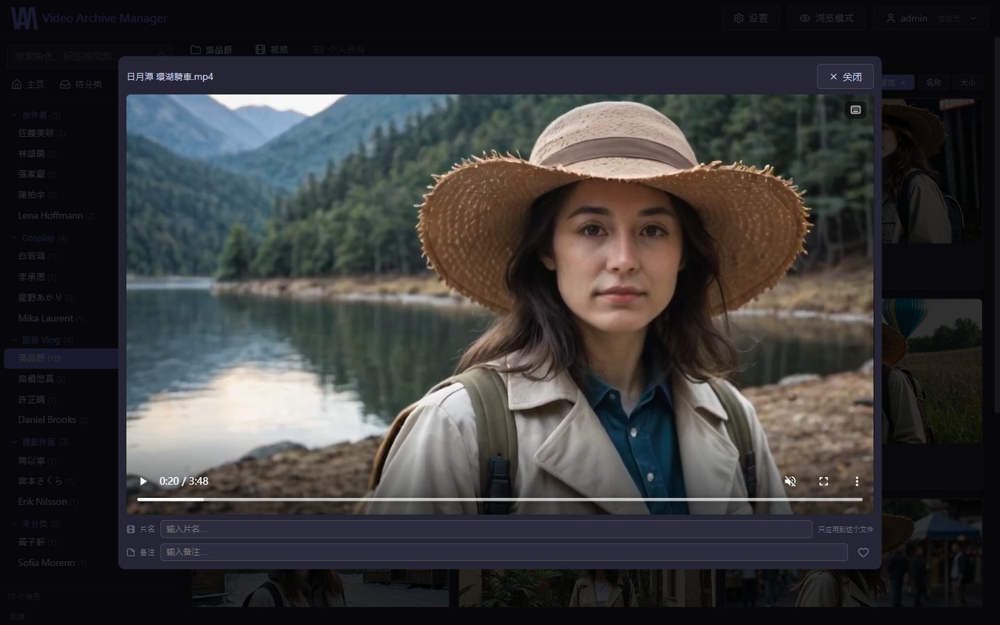</p>

## 照片管理

- 每位角色独立的照片墙，可按时间、名称、文件大小、**相似度**（构图＋颜色）排序，也能用相册方式浏览。
- 缩略图由服务器生成并缓存，点开才加载原图。
- **手机版**：照片上下滑动切换、双指缩放，界面针对触控重新排版。

<table>
  <tr>
    <td width="40%">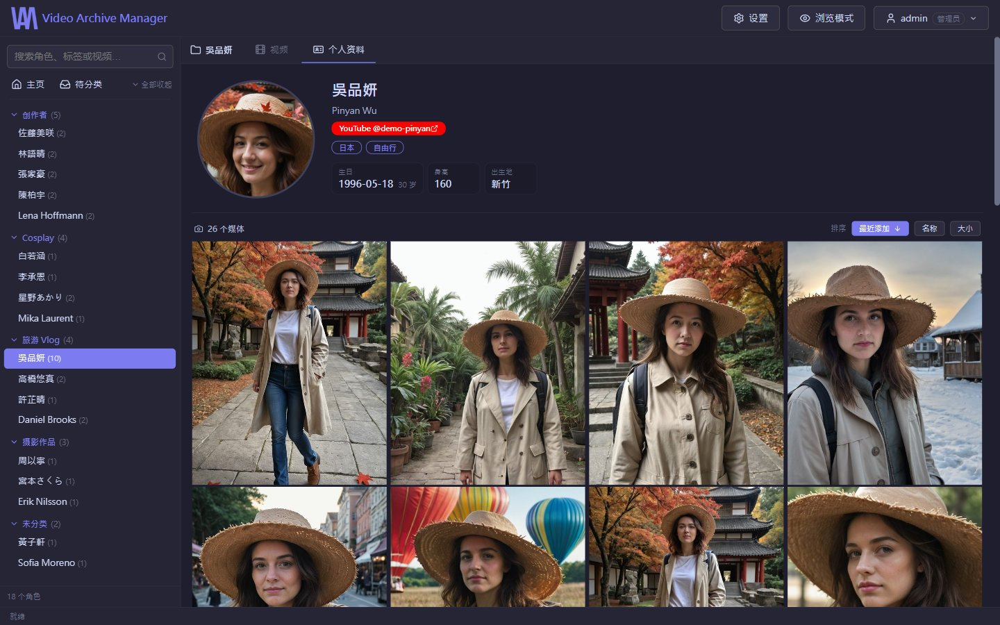</td>
    <td width="40%">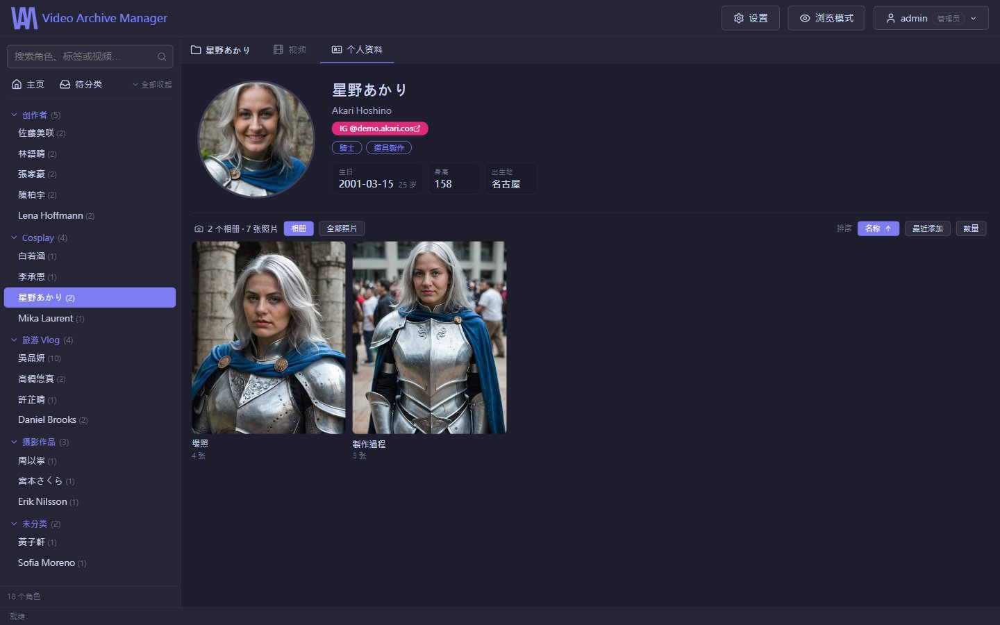</td>
    <td width="20%">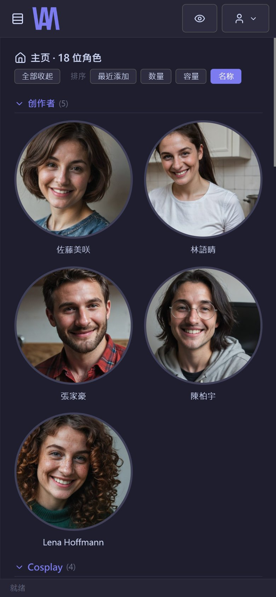</td>
  </tr>
  <tr>
    <td align="center">个人资料、社交链接与照片墙</td>
    <td align="center">按子文件夹分成相册</td>
    <td align="center">手机版</td>
  </tr>
</table>

---

# 整理与归档

- **待分类工作流程**：预览、观看、确认后归档；移动文件时可以继续选下一个。
- **整包归档**：一次把整个文件夹归档到某位角色。
- **角色管理**：改名、合并角色文件夹、自定义标签（可直接用来筛选）、社交链接、个人资料、头像框选。
- **NFO**：读入与写出 Kodi／Jellyfin／Emby 的 `.nfo`，读入时只补空的字段，不覆盖你改过的内容。

<p align="center">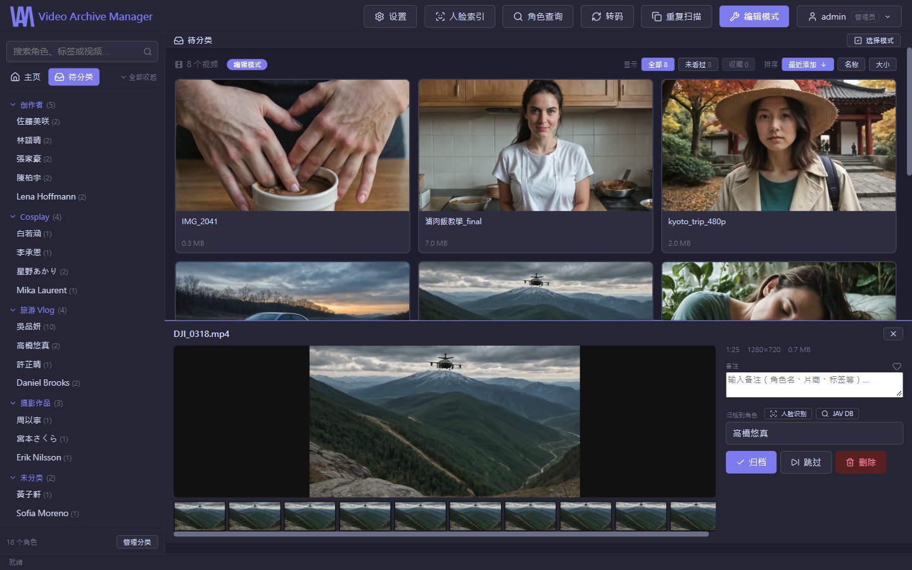</p>

---

# 重复文件扫描

- **视频**：先比较大小与哈希（完全相同），再比较时长与画面指纹（同一部、不同画质或版本），并建议保留哪一个。
- **图片**：比对完全相同与高度相似的照片，能识别带水印的版本。
- 扫描可以中途停止，服务器重启后自动接续；删除前都会先列出清单让你确认。

<p align="center">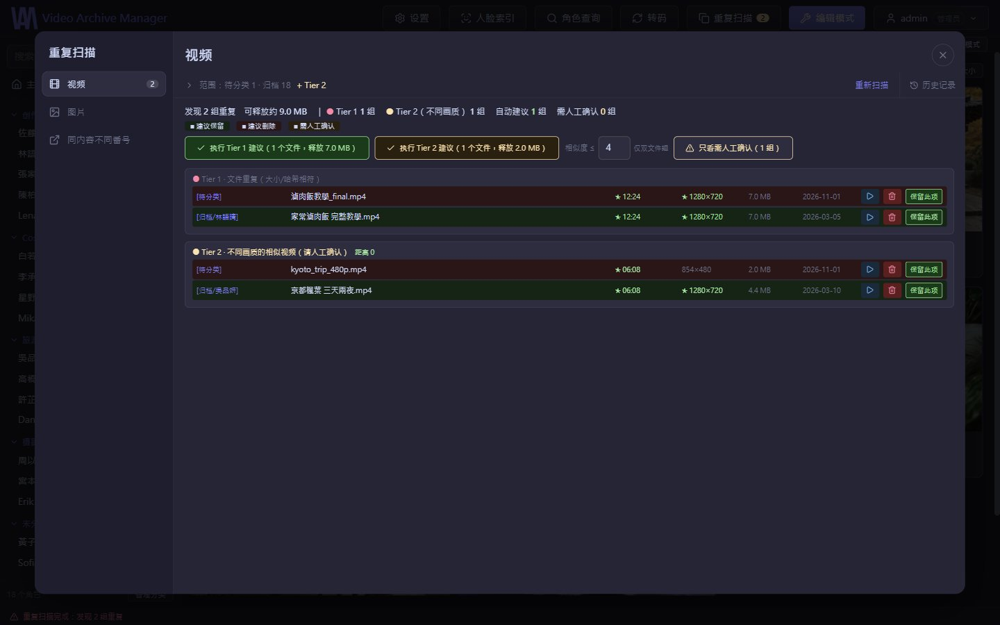</p>

---

# AI 辅助整理（可选，需另外安装）

- **人物检测**：找出照片文件夹里“没有人物”的照片（风景、食物、物品），方便清理。有 NVIDIA GPU 时每张约 0.07 秒；没有也能运行，慢约 5 倍。
- **人脸识别**：对待分类的视频做人脸分析，根据已建立的角色建议可能是谁。需要 NVIDIA GPU。

没安装的话，这两个功能会在界面上直接说明缺少什么套件或模型，其他功能完全不受影响。安装方式见下方“AI 功能”。

---

# 视频处理工具

所有会改动视频的工具都有**验证**步骤：验证不通过就不删除原文件。

- **转码**：浏览器播放不了的视频，优先尝试**不重新编码的换封装（Remux）**，必要时才重新编码。
- **修复**：抢救被误标成 `.ts` 的分段 MP4、遮蔽损坏的画面、修正声音断流与录像中断、修正造成卡顿的帧时间。
- **完整解码检查**：逐帧解码一遍，找出看起来正常、其实中间坏掉的文件。
- **压缩**：重新编码以节省空间，**一律另存为新文件**；可以把原始版本与压缩版本并排同步播放，比较画质后再决定保留哪个。
- **剪辑**：一次选择多个片段并合并成一个视频；先从缩略图表选择大致范围，再用播放器微调。可选“快速（吸附关键帧、不损失画质）”或“精确到帧（重新编码）”。

<p align="center">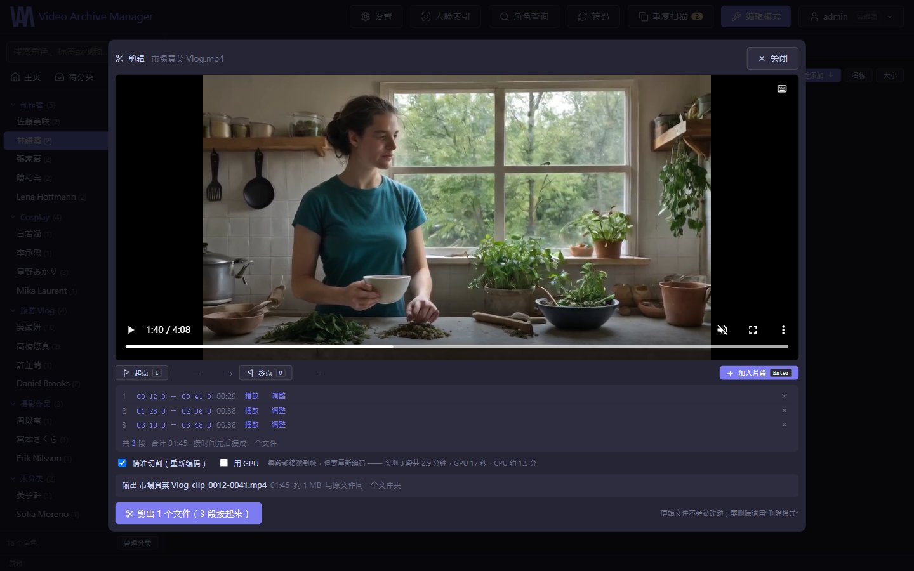</p>

---

# 数据补全（角色查询）

- **片名与发行日期**：用番号查询 DMM 的公开目录，获取日文原名与发行日期；查不到的再找 JAVDatabase。
- **封面**：同时下载竖版封面与横版封套，保存为视频旁的 `-poster.jpg`／`-fanart.jpg`。
- **个人资料与头像**：从 JAVDatabase 补全生日、身高等字段；头像候选来自 [Gfriends](https://github.com/gfriends/gfriends) 图库。已有的数据逐栏列出“当前 → 新值”，勾选才替换。
- **导入自己保存的网页**：Seesaa Wiki、IAFD、AVBase。解析作品列表、别名、个人资料，以及“哪部是从哪部剪出来的”收录关系（总集篇、精选）。
- **共演**：从数据推算哪些角色一起出演过。

> 数据来源都是公开网站。请遵守各网站的使用条款；VAM 不绕过任何地区限制或防护机制。

---

# 账号、权限与安全

- **权限组**：管理员可以自定义权限组，逐项勾选能用哪些功能（归档、删除、去重、转码、剪辑、角色查询…）。权限在服务器端强制执行，不只是把按钮藏起来。
- **可访问的文件夹**：每个账号可以限制只能看到哪些根目录。
- **两步验证**：TOTP（Google Authenticator 等）＋备用码；有编辑权限的账号强制开启。二维码在本地生成，密钥不经过任何外部服务。
- **登录防护**：“账号＋地址”“地址”“账号”三条限流规则，逐步延长锁定时间；密码强度规则；IP 白名单。
- **异常通知**：从未用过的地址登录成功、两步验证被关闭等事件会提醒管理员；可以查看并退出任何一台已登录的设备。
- **外部连接**：默认只接受局域网与 VPN 来源。需要从外部连接时，可搭配 Caddy 申请正式 HTTPS 证书（模板在 `caddy/Caddyfile.example`）。
- **备份**：每天把数据库备份到你指定的另一块硬盘。
- **界面语言**：繁体中文、简体中文、English。每个账号各自选择，保存在账号里，换一台设备登录也一样；登录页面使用这台浏览器上次用的语言。

<p align="center">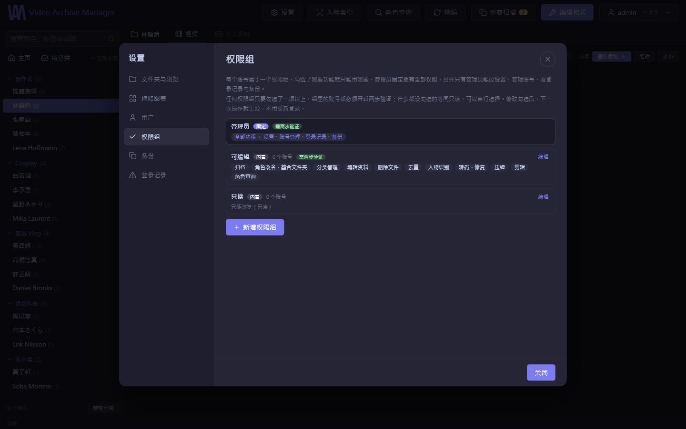</p>

---

# 安装与运行

目前在 **Windows 10／11** 上开发与使用，启动脚本是 `.bat`。后端是 Python，理论上也能在 Linux／macOS 运行，但没有测试过。

安装分三层，**只有第一层是必需的**。缺少的可选组件不会让 VAM 出错：对应的功能会在界面上说明缺少什么。

| 功能 | 需要 | 属于 |
|---|---|---|
| 浏览、播放、归档、角色管理、视频去重、数据补全、账号权限 | Python、`requirements.txt` | 1. 基本 |
| **剪辑、转码、压缩、修复、缩略图表、读取视频时长** | **FFmpeg** | 1. 基本 |
| 网页界面（构建一次） | Node.js | 1. 基本 |
| 缩略图表拼贴、照片缩略图、图片去重、相似排序 | Pillow | 2. 建议 |
| 帧时序修复 | GPAC 的 `MP4Box` | 2. 可选 |
| 人脸识别 | `requirements-ai.txt`、NVIDIA GPU | 3. AI |
| 人物检测 | `requirements-ai.txt`、模型文件（GPU 可选） | 3. AI |

### 1. 基本安装

先安装三个程序（以 Windows 的 winget 为例，也可以到官网下载）：

```bat
winget install Python.Python.3.11
winget install Gyan.FFmpeg
winget install OpenJS.NodeJS.LTS
```

装完后**重新打开一个命令行窗口**，确认 `python --version`、`ffmpeg -version`、`node --version` 都有输出。
FFmpeg 必须在 PATH 中：剪辑、转码、缩略图表都是调用它完成的。有 NVIDIA 显卡时，转码会自动改用显卡编码，不需要另外设置。

下载 VAM 并安装 Python 套件：

```bat
git clone https://github.com/lawlint312/Video-Archive-Manager.git
cd Video-Archive-Manager
pip install -r backend/requirements.txt
```

构建网页界面。只需要做一次，之后运行 VAM 时用不到 Node：

```bat
cd frontend
npm install
npm run build
cd ..
```

第一次启动前，设置管理员密码（没设置的话会生成一组随机密码，写在 `data\logs\` 的日志文件里）：

```bat
set VAM_ADMIN_PASSWORD=你的密码
start.bat
```

然后打开 **http://localhost:8301/**，用 `admin` 登录。要切换成简体中文界面，打开右上角的账号菜单，在“語言”下选择 **简体中文**。接着到 **设置 → 文件夹与浏览** 加入你的收藏根目录与待分类文件夹。

### 2. 建议与可选组件

**建议**安装 Pillow，缩略图表、照片缩略图、图片去重、相似排序都需要它：

```bat
pip install Pillow
```

**可选**：帧时序修复需要 GPAC 的 MP4Box：

```bat
winget install GPAC.GPAC
```

装完后重新启动 VAM（`stop.bat` 再 `start.bat`）。

### 3. AI 功能（可选）

需要的空间与条件比其他功能大得多，请先确认需要再安装：

- 硬盘约 **10 GB**（PyTorch 的 GPU 版就占 7.5 GB）
- **NVIDIA 显卡**（GTX 16／RTX 20 系列或更新）与 580 版以上的驱动程序（套件使用 CUDA 13）；CUDA 与 cuDNN 由 pip 一并安装，不必另外安装
- Windows 上 `insightface` 没有预编译版本，安装时需要编译，要先安装
  [Microsoft C++ Build Tools](https://visualstudio.microsoft.com/visual-cpp-build-tools/)（勾选“使用 C++ 的桌面开发”）

```bat
pip install -r backend/requirements-ai.txt
```

**人脸识别**：装完套件即可。第一次使用时会自动下载 insightface 的 `buffalo_l` 模型（约 300 MB）。
注意：这个模型的授权**仅限非商业研究用途**，使用前请自行确认 [insightface 的授权条款](https://github.com/deepinsight/insightface#license)。

**人物检测**：另外需要模型文件。从 Hugging Face 的
[Bingsu/adetailer](https://huggingface.co/Bingsu/adetailer/blob/main/person_yolov8m-seg.pt)
下载 `person_yolov8m-seg.pt`（约 55 MB），放到：

```
data\models\person_yolov8m-seg.pt
```

重新启动 VAM 后，在角色的照片页就能使用“识别人物”与“没有人物”筛选。

### 文件夹结构

```
收藏根目录\
├── 角色 A\                    ← 一个文件夹就是一位角色
│   ├── person_info.json      ← 个人资料、标签、链接（在 VAM 里编辑时写入）
│   ├── 视频1.mp4
│   ├── 番号-poster.jpg        ← 可选：封面
│   └── 照片1.jpg
└── 角色 B\...
```

### 启动方式

| 文件 | 作用 |
|---|---|
| `start.bat` | 手动启动，只有这台电脑能连接 |
| `start-lan.bat` | 同上，但开放给同一局域网的手机、平板 |
| `start-hidden.vbs`／`start-lan-hidden.vbs` | 没有窗口，放进“启动”文件夹就能开机自动运行 |
| `status.bat` | 有没有在运行、监听哪里、最新的日志 |
| `stop.bat` | 停止 |

详细说明见 `README-startup.txt`（繁体中文）。

### 环境变量

| 变量 | 默认值 | 说明 |
|---|---|---|
| `VAM_ADMIN_USER`／`VAM_ADMIN_PASSWORD` | `admin`／随机 | 第一次启动时创建的管理员 |
| `VAM_HOST`／`VAM_PORT` | `127.0.0.1`／`8301` | 监听地址 |
| `VAM_DATA_DIR` | `data\` | 数据库、日志文件 |
| `VAM_CACHE_DIR` | `cache\thumbs\` | 缩略图缓存（可以随时删除，会自动重新生成） |
| `VAM_SESSION_DAYS` | `7` | 登录有效天数 |

### 测试

每个测试文件都可以单独运行。后端的在 `backend\tests\`，前端的在 `frontend\tests\`：

```bat
cd backend
python -X utf8 tests\test_security.py
cd ..\frontend
node tests\mount.test.mjs
```

测试只使用临时文件夹与 `testdata\` 里的人造素材，不会碰到你的收藏。

---

# VAM 想解决的问题

当视频与照片收藏逐渐增加到数千甚至数万个文件后，真正困难的通常已经不是“播放视频”，而是：

**如何查找、分类、识别、整理、去重，以及长期维护这些收藏。**

VAM 将视频浏览、角色管理、照片管理、重复扫描、人脸识别、人物检测、视频转码、压缩、剪辑与外部数据导入整合在同一套 Web 系统中。

> **让管理大量影音收藏，从繁琐的文件整理工作，变成可以通过浏览器快速完成的日常流程。**

---

## 授权

Copyright © 2026 lawlint312

本项目以 [GNU Affero General Public License v3.0](LICENSE)（AGPL-3.0）授权：可以自由使用、修改与分发；修改后的版本——包括架设成网络服务供他人使用——必须以相同授权公开源代码。

本项目使用 Claude Code 协助开发。
